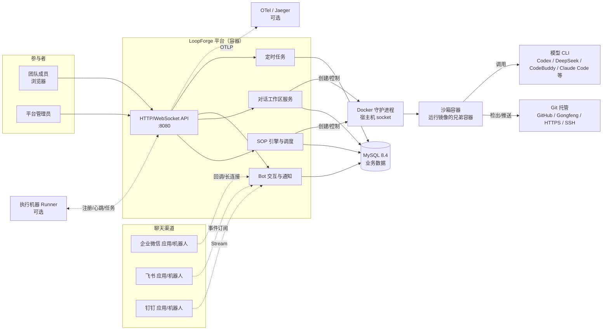
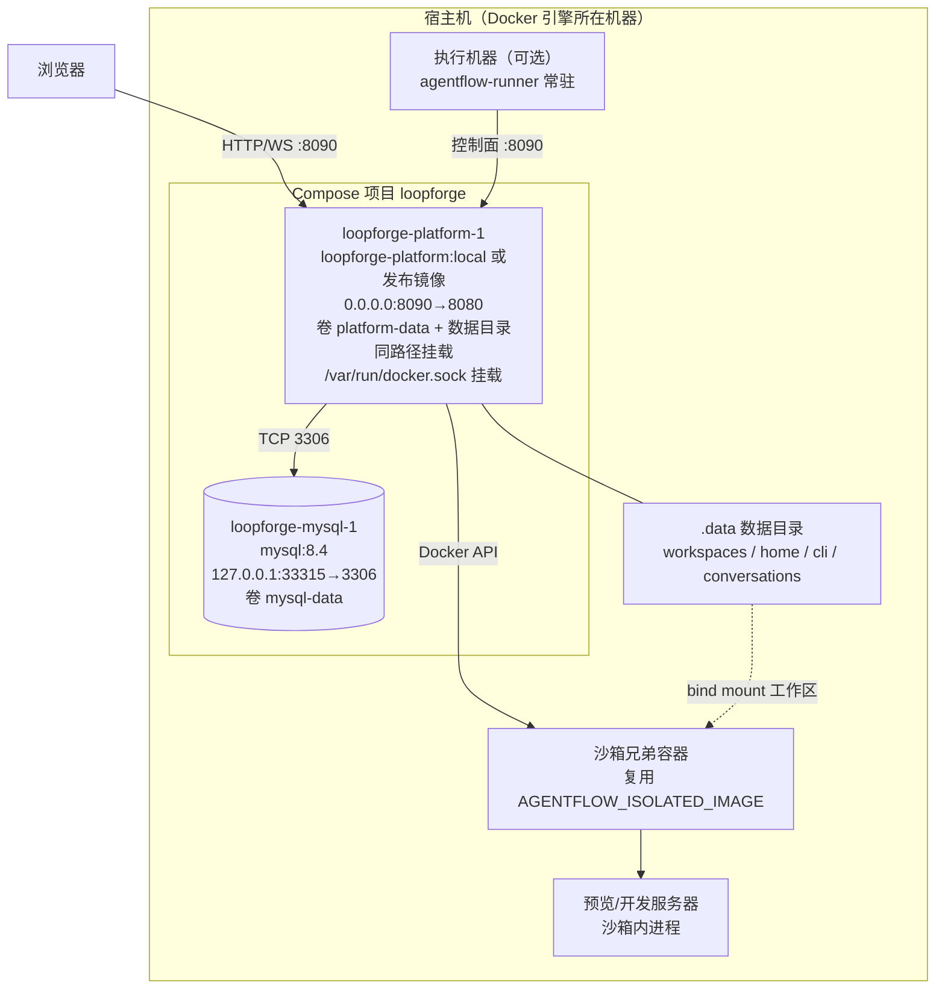
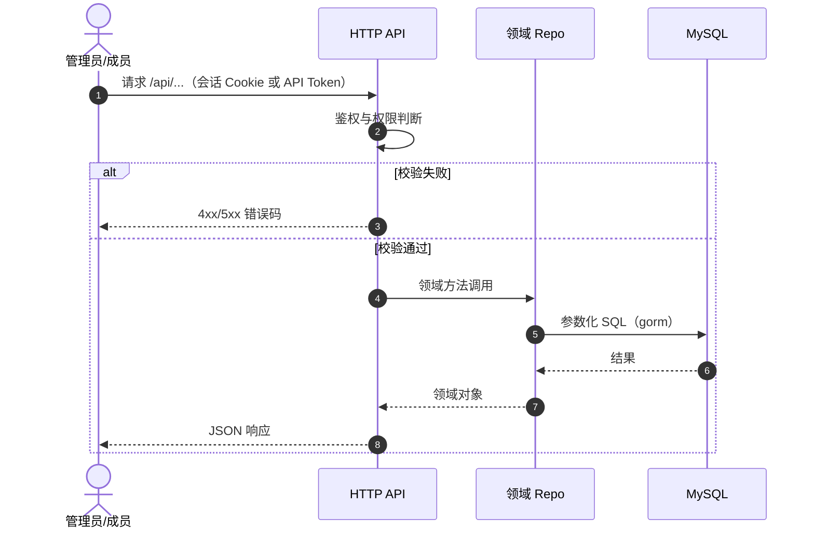
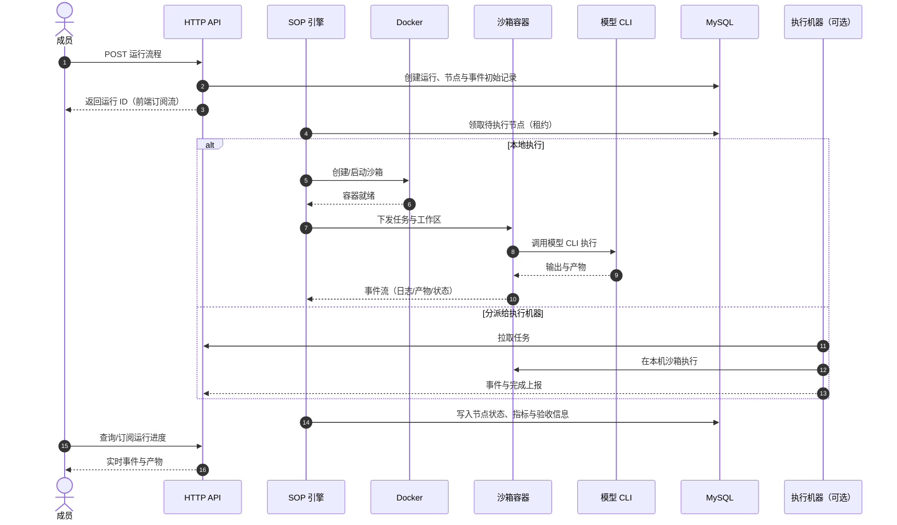

# 架构全景图

> 项目：LoopForge
> 状态：当前代码快照
> 证据基线：`develop` @ `6833a9fb`
> 适用范围：系统边界、部署拓扑与运行时链路；单功能分支见 `docs/流程/`，组件职责与数据表见 `docs/功能/01-项目架构.md`

## 1. 系统上下文

LoopForge 是团队内部的编码 Agent 编排平台：成员在浏览器对话工作台或聊天渠道（企业微信、飞书、钉钉）提出需求，平台把需求分派给 SOP（步骤图）或直接会话，由模型 CLI 在沙箱容器中执行，运行在人工审批关口暂停，最终产出文档、代码分支或 MR。

图中虚线表示异步、长连接或外部系统；`MySQL`、`Docker`、`Runner`、`Git`、`CLI`、`OTel` 均为平台之外或平台只做编排的组件。

## 2. 部署拓扑

默认安装是两容器栈：MySQL 与平台。平台通过挂载的宿主机 Docker socket 启动沙箱兄弟容器；数据目录以相同绝对路径挂进平台容器，供沙箱 bind mount 使用。

关键事实：

- MySQL 只发布到 `127.0.0.1:${LOOPFORGE_MYSQL_PORT:-33315}`，平台通过 Compose 网络内的 `mysql:3306` 访问。
- 平台监听 `${LOOPFORGE_BIND:-0.0.0.0}:${AGENTFLOW_HTTP_PORT:-8090}`；容器内实际端口 `8080`。
- 平台容器挂载 `/var/run/docker.sock`，因此能启动兄弟沙箱；只应部署在可信团队内。
- `LOOPFORGE_DATA_DIR`（默认 `./.data`）以相同绝对路径挂载进平台容器，沙箱工作区由宿主机 Docker 解析 bind mount。
- 执行机器（Runner）与平台之间是出站/控制面连接，不要求 Runner 可被平台主动拨入。

## 3. 运行时链路

### 3.1 一次管理变更（同步请求）

### 3.2 一次 SOP 运行（异步编排）

## 4. 与功能文档的分工

| 关注点 | 文档 |
| --- | --- |
| 组件职责、进程角色、领域 Repo、数据表、启动顺序 | [功能/01-项目架构.md](功能/01-项目架构.md) |
| 路由、MCP 操作、任务入口与统计口径 | [功能/02-功能清单.md](功能/02-功能清单.md) |
| 术语与代码映射 | [功能/03-领域术语表.md](功能/03-领域术语表.md) |
| 单功能流程图、时序图与关键异常 | `docs/流程/` |
| 部署、账号、沙箱边界 | [功能/05-部署与运维.md](功能/05-部署与运维.md) |

## 5. 证据索引

| 主题 | 证据位置 |
| --- | --- |
| 进程入口与角色 | `cmd/agentflow/main.go`（`-role`：api/worker/all） |
| HTTP 路由装配 | `internal/httpapi/server.go` |
| 引擎与调度 | `internal/engine/` |
| 数据访问 | `internal/repo/`（按领域拆分 Repo） |
| 沙箱与运行时 | `internal/runtime/`、`internal/runner/` |
| 渠道 Bot | `internal/botinteraction/channel_wecom.go`、`channel_feishu.go`、`channel_dingtalk.go` |
| 定时任务 | `internal/schedule/service.go` |
| 部署拓扑 | `compose.yaml`、`compose.dev.yaml`、`Dockerfile` |
| 官方部署说明 | [功能/05-部署与运维.md](功能/05-部署与运维.md)（原 `docs/deployment.md`） |

## 6. 待确认与风险

- 发布镜像默认 pin 在 `compose.yaml`，源码构建走 `compose.dev.yaml`；两者拓扑一致，仅镜像来源不同。
- 平台容器内没有 bubblewrap，native 沙箱只能跑在原生安装或执行机器上（见 [功能/05-部署与运维.md](功能/05-部署与运维.md)）。
- Docker socket 等价宿主机 root 权限，这是可信团队假设的前提。
