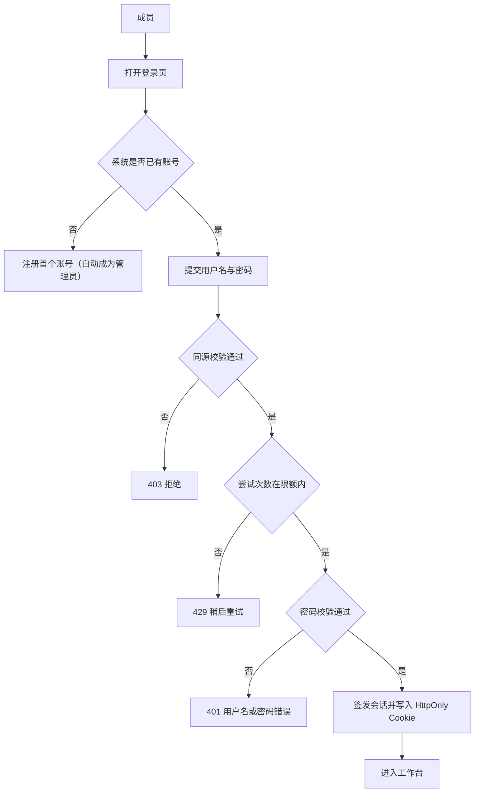
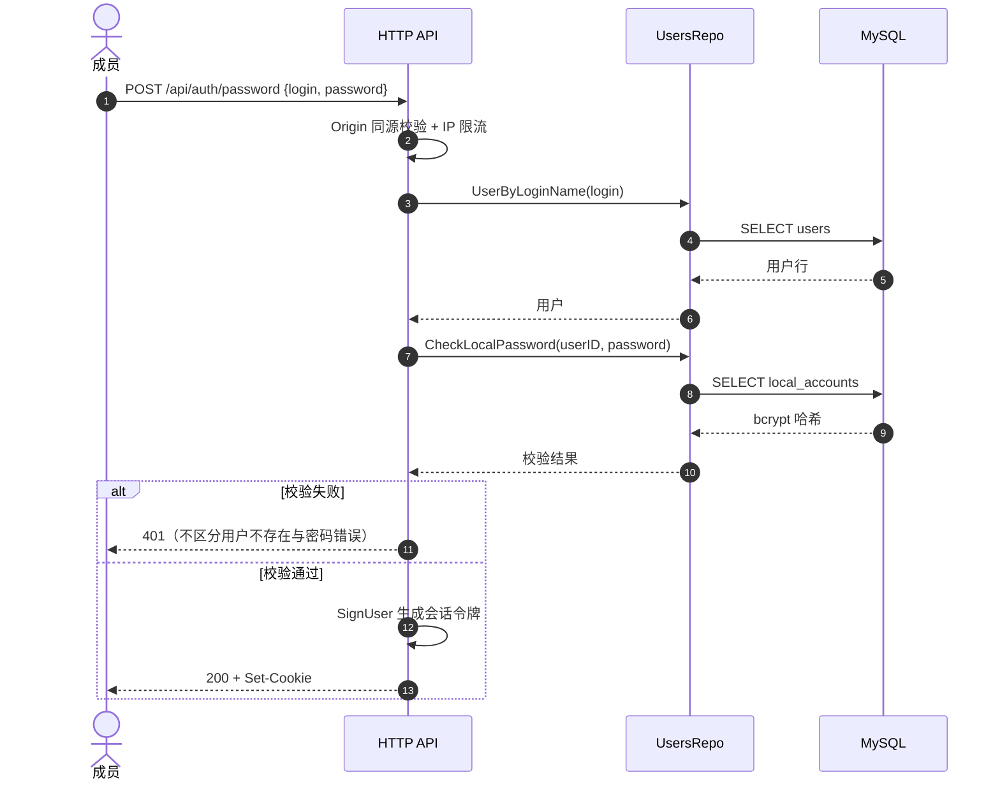
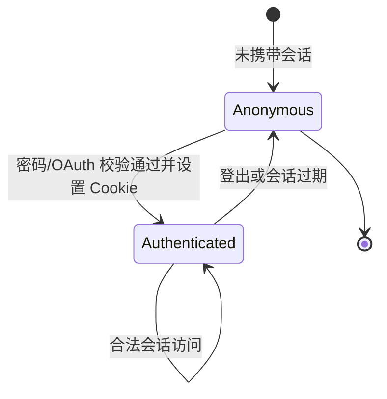

# 01 登录与账号（v1）

> 文档编号：01
> 文档版本：v1
> 项目：LoopForge
> 关联接口：`POST /api/auth/password`、`GET /api/auth/setup`、`POST /api/auth/register`、`POST /api/auth/logout`
> 状态：已实现
> 证据基线：`develop` @ `6833a9fb`

## 1. 流程目标

成员用用户名与密码（或 GitHub/Gongfeng OAuth）换取会话 Cookie，之后携带 Cookie 访问平台；首次安装时第一个注册账号成为平台管理员。

## 2. 参与角色与前置条件

| 角色 | 职责 |
| --- | --- |
| 成员 | 在登录页提交用户名与密码 |
| HTTP API | 校验同源、限流、查用户、校验密码、签发会话 |
| UsersRepo | 读取用户与本地账号（bcrypt 哈希） |
| MySQL | 持久化用户、local_accounts、API Token |

前置条件：`AGENTFLOW_AUTH_REQUIRED=true`（默认）；管理员已通过安装流程或 `loopforge-account` 建立账号；浏览器与服务同源访问。

## 3. 主流程图

## 4. 时序图

## 5. 状态机

说明：会话有效期与签名由 `AGENTFLOW_SESSION_SECRET` 决定；该密钥变化会使既有会话失效。

## 6. 关键异常与分支

| 场景 | 当前处理 |
| --- | --- |
| 跨站请求 | 校验 `Origin` 与服务 Host 一致，否则 403 |
| 暴力尝试 | 按客户端 IP 的窗口限流，超出返回 429 |
| 用户名不存在 | 与密码错误同样返回 401，不泄露账号是否存在 |
| 请求体过大 | 限制 4KB，返回 400 |
| 首个账号 | setup 流程要求创建管理员；之后注册为普通成员（`AGENTFLOW_ALLOW_SIGNUP`） |
| 会话密钥变更 | 所有既有 Cookie 失效，需要重新登录 |

## 7. 证据索引

| 证据 | 位置 |
| --- | --- |
| 密码登录 | `internal/httpapi/auth_password.go`（`authPassword`） |
| 会话 Cookie | `internal/httpapi/auth.go`（`setAuthCookie`） |
| 本地账号与 bcrypt | `internal/repo/local_accounts.go` |
| 注册与 setup | `internal/httpapi/auth_register.go` |
| 账号工具 | `cmd/loopforge-account/main.go` |
| 会话密钥 | `AGENTFLOW_SESSION_SECRET`（`compose.yaml`、`.env`） |

## 8. 实现风险与待确认

- 会话 Cookie 的 Secure 属性依赖 `AGENTFLOW_SECURE_COOKIES`；HTTPS 终止在反代时必须开启。
- 企业身份网关头登录（`AGENTFLOW_TRUST_IDENTITY_HEADERS`）是另一条路径，默认关闭，未纳入本流程。
