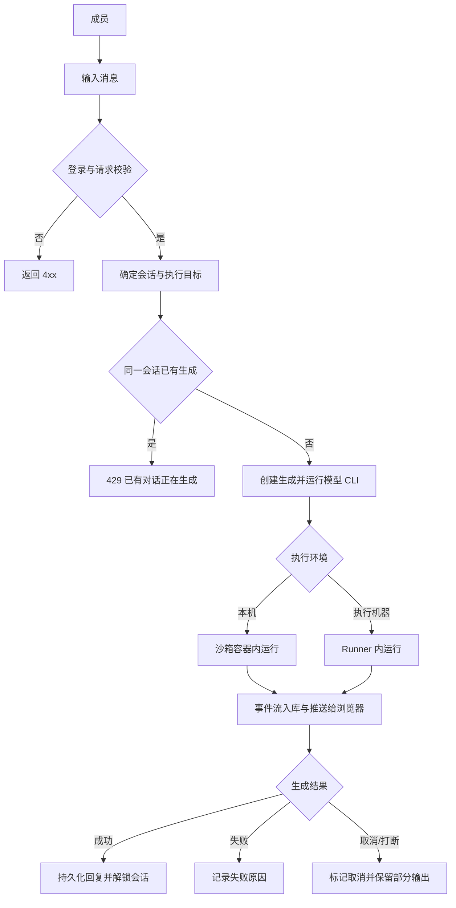
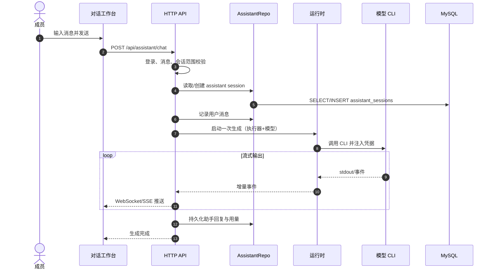
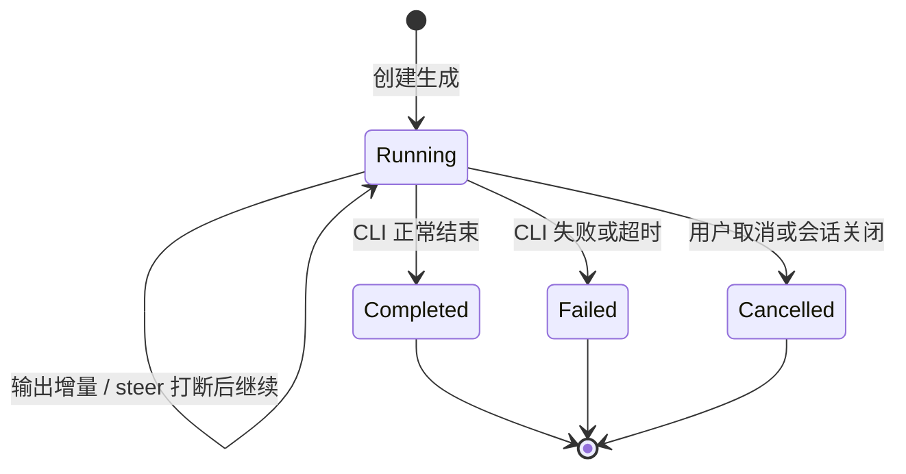

# 02 对话工作台（v1）

> 文档编号：02
> 文档版本：v1
> 项目：LoopForge
> 关联接口：`POST /api/assistant/chat`、`POST /api/assistant/generations`、`GET /api/assistant/sessions/:id/generation`、`POST /api/assistant/sessions/:id/generation/steer`
> 状态：已实现
> 证据基线：`develop` @ `6833a9fb`

## 1. 流程目标

成员在对话工作台输入需求或指令，平台选择执行器与模型，在沙箱或执行机器中运行模型 CLI，实时把输出流回浏览器并持久化会话记录。

## 2. 参与角色与前置条件

| 角色 | 职责 |
| --- | --- |
| 成员 | 输入消息、选择执行器/模型/确认方式 |
| 对话工作台 | 消息编排、流式渲染、附件与审批交互 |
| assistantHandlers | 校验请求、确定会话与执行目标、启动生成 |
| 运行时 | 启动模型 CLI 进程、转发事件 |
| 沙箱 / 执行机器 | 承载 CLI 进程与工作区 |
| MySQL | 持久化 assistant_sessions、generations、messages |

前置条件：已登录；至少有可用执行器凭据（或执行机器已登录 CLI）；会话创建后执行目标固定，不能中途更换。

## 3. 主流程图

## 4. 时序图

## 5. 状态机

状态取值证据：`internal/domain/assistant_generation.go` 与生成处理代码中的 `running`、`completed`、`failed`、`cancelled`。

## 6. 关键异常与分支

| 场景 | 当前处理 |
| --- | --- |
| 未登录 | 401，提示先登录 |
| 消息为空或最后一条不是用户消息 | 400 |
| 会话已有生成在跑 | 429，拒绝并发 |
| 会话已固定执行机器却请求更换 | 409，要求新建对话 |
| CLI 缺失 | 会话内提示安装动作；安装后重试 |
| 用户中途 steer | 打断当前轮并立即发送新指令 |
| 模型/凭据错误 | 生成标记失败并记录诊断信息 |

## 7. 证据索引

| 证据 | 位置 |
| --- | --- |
| 对话入口 | `internal/httpapi/assistant.go`（`chat`） |
| 生成入口 | `internal/httpapi/assistant_generation.go`（`startGeneration`） |
| 会话与生成模型 | `internal/domain/assistant.go`、`assistant_generation.go` |
| 执行目标切换限制 | `assistant.go`（`ExecutionLocked` 分支） |
| 流式推送 | `internal/httpapi/assistant_stream.go`、`assistant_live.go` |
| 运行时与 CLI | `internal/runtime/`、`assistant_engine_*.go` |

## 8. 实现风险与待确认

- 对话工作台的执行目标（本机沙箱 / 执行机器）在会话创建后固定，属于产品约束，不是缺陷。
- 生成失败的具体分类（凭据、网络、CLI 崩溃）分散在诊断模块，跨渠道错误文案未统一。
