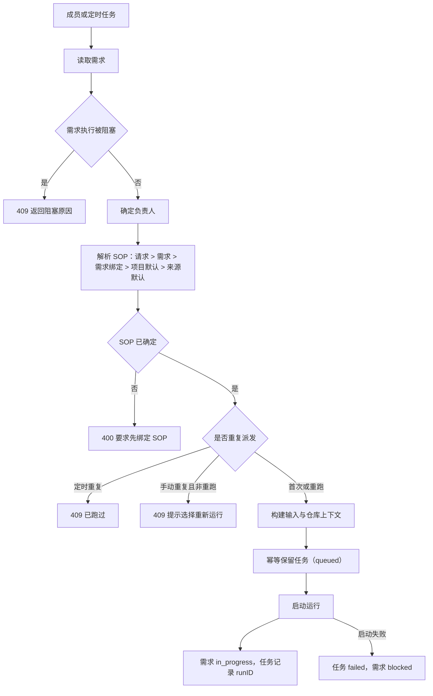
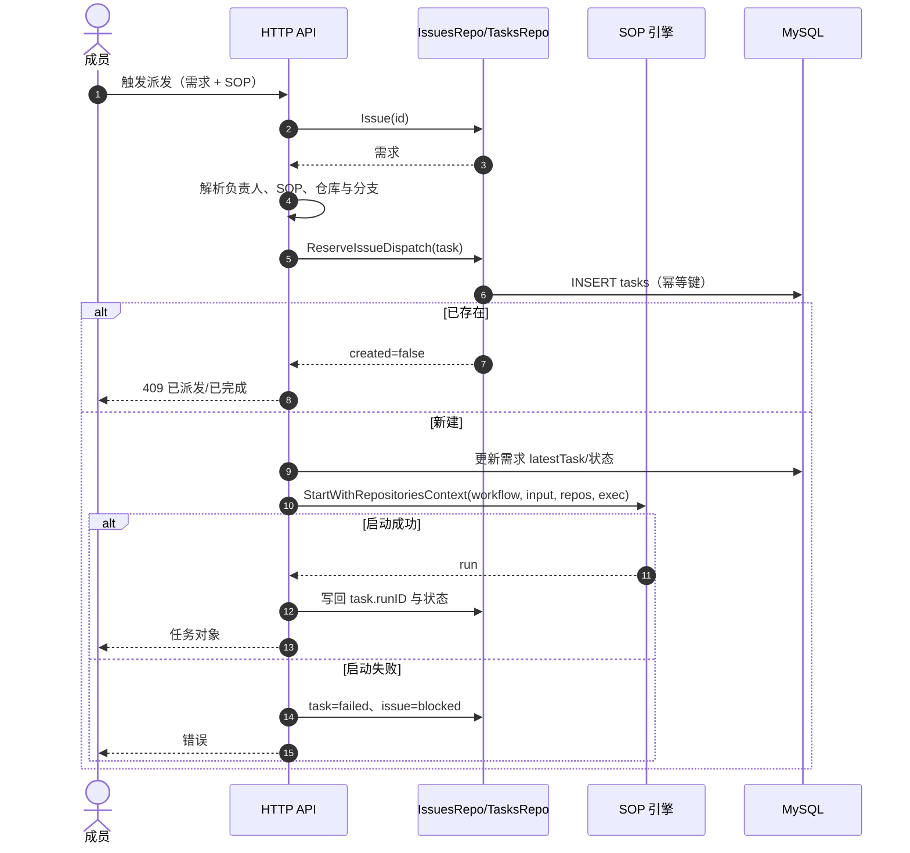
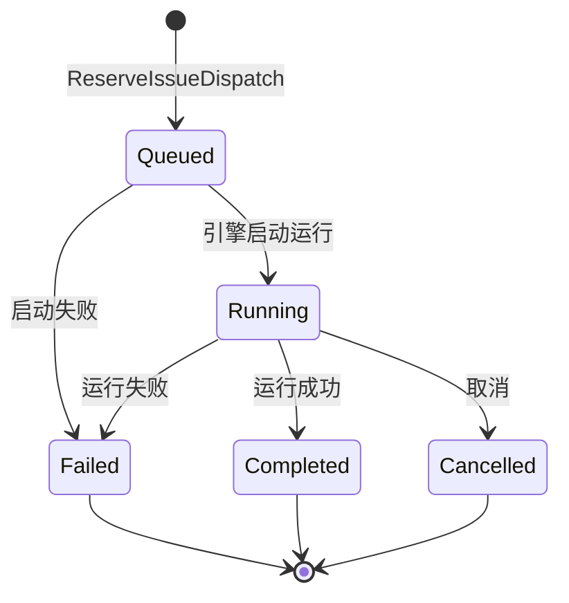

# 03 需求与SOP派发（v1）

> 文档编号：03
> 文档版本：v1
> 项目：LoopForge
> 关联接口：`POST /api/issues/:id/dispatch`（派发入口，具体路径见接口附录）、`POST /api/runs`
> 状态：已实现
> 证据基线：`develop` @ `6833a9fb`

## 1. 流程目标

把一条需求绑定到一个 SOP（流程模板），创建幂等的派发任务并启动运行；重复派发、定时任务与重跑都有明确判定规则。

## 2. 参与角色与前置条件

| 角色 | 职责 |
| --- | --- |
| 成员 / 定时任务 | 触发派发，选择或继承 SOP 与仓库 |
| HTTP API | 解析 SOP、负责人、仓库与分支，创建任务 |
| IssuesRepo / TasksRepo | 幂等保留任务、更新需求状态 |
| SOP 引擎 | 用仓库上下文启动运行 |
| MySQL | issues、tasks、runs |

前置条件：需求存在且未阻塞；已解析出 SOP（需求绑定、项目默认、来源默认之一）；仓库绑定有效；同一 SOP 未被重复派发（除非显式重跑）。

## 3. 主流程图

## 4. 时序图

## 5. 状态机

任务状态取值来自 `internal/domain/task.go` 注释：`queued, dispatched, running, completed, failed, cancelled`；本流程实际写入 `queued`、启动失败 `failed`，运行后由 `taskStatusFromRun` 映射。

## 6. 关键异常与分支

| 场景 | 当前处理 |
| --- | --- |
| 需求不使用 SOP | 必须显式提供 SOP，否则 400 |
| 同一 SOP 已跑过 | 手动派发提示「重新运行」，定时任务直接 409 |
| 重跑但该 SOP 未跑过 | 400，拒绝无依据的重跑 |
| 定时任务遇到已跑过的需求 | 409，定时只处理未触碰需求 |
| 绑定仓库无效 | 400，仓库必须属于当前项目 |
| 启动运行失败 | 任务 failed、需求 blocked，保留错误供重试 |
| 并发派发 | `ReserveIssueDispatch` 唯一键保证只有一个成功 |

## 7. 证据索引

| 证据 | 位置 |
| --- | --- |
| 派发主逻辑 | `internal/httpapi/dispatch.go`（`dispatchIssue`） |
| 幂等任务键 | `dispatch.go`（`primaryTaskID`） |
| SOP 解析优先级 | `internal/domain/issue_sop.go`（`ResolveSOPBindings`） |
| 任务状态 | `internal/domain/task.go` |
| 运行启动 | `internal/engine/run_start.go` |
| 需求状态 | `internal/domain/issue.go` |

## 8. 实现风险与待确认

- SOP 解析有五个回退层级，排障时需按顺序核对；文档与界面提示应展示最终选中的 SOP。
- 定时任务与手动派发共用同一任务键，但冲突处理不同（定时直接 409，手动提示重跑）。
- 启动失败会把需求置为 `blocked`，是否自动恢复需运维/产品确认。
