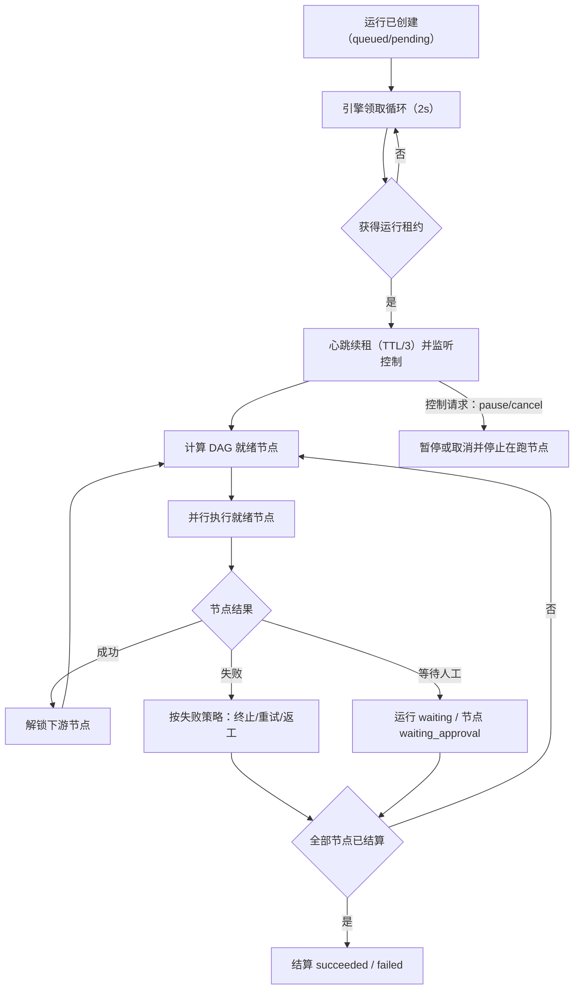
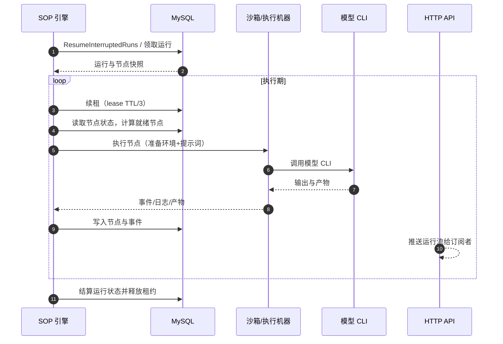
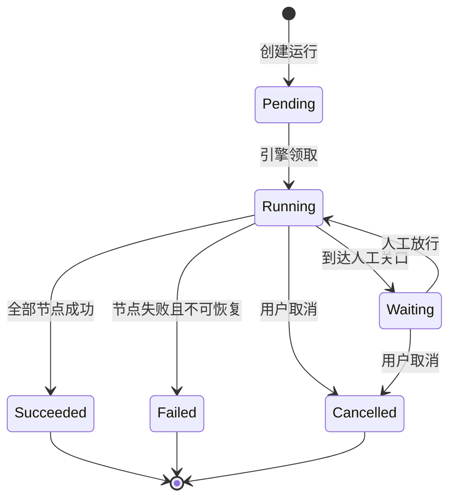

# 04 SOP运行与节点执行（v1）

> 文档编号：04
> 文档版本：v1
> 项目：LoopForge
> 关联接口：`GET /api/runs/:id/stream`、`POST /api/runs/:id/pause`、`POST /api/runs/:id/resume`、`POST /api/runs/:id/cancel`
> 状态：已实现
> 证据基线：`develop` @ `6833a9fb`

## 1. 流程目标

引擎领取已启动的 SOP 运行，按 DAG 依赖把就绪节点并行执行；节点在沙箱或执行机器中跑模型 CLI，事件与产物实时入库；全部节点结束、暂停或取消后结算运行。

## 2. 参与角色与前置条件

| 角色 | 职责 |
| --- | --- |
| 成员 | 启动/暂停/恢复/取消运行，订阅进度 |
| SOP 引擎 | 领取运行、续租、调度就绪节点、结算状态 |
| 沙箱 / 执行机器 | 实际执行节点命令与模型 CLI |
| MySQL | runs、run_nodes、run_events、run_artifacts、租约 |

前置条件：运行已由派发或手动启动写入 `runs`；存在可执行的引擎实例（`role=worker/all`）；工作区与仓库准备完成。

## 3. 主流程图

## 4. 时序图

## 5. 状态机

补充：节点级状态包含 `waiting_approval`（人工关口）与 `pending_input`（等待补充信息）；`paused` 是 Bot 澄清会话的状态，不是运行状态。

## 6. 关键异常与分支

| 场景 | 当前处理 |
| --- | --- |
| 实例重启 | `ResumeInterruptedRuns` 周期性恢复中断运行 |
| 租约丢失 | 心跳续租失败即取消本地执行，避免双写 |
| 用户暂停 | `PauseRequested` 停止在跑节点后写入暂停态 |
| 用户取消 | `CancelRequested` 停止节点并结算 cancelled |
| 节点等待人工 | 运行置 waiting，节点 waiting_approval，等待审批 |
| 分支失败 | 按节点失败策略终止、重试或返工，不让同批节点继续写终态 |
| 红线：状态终态后被写 | `stopNodes` 先取消并等待节点退出，再写终态 |

## 7. 证据索引

| 证据 | 位置 |
| --- | --- |
| 启动运行 | `internal/engine/run_start.go` |
| 领取循环 | `internal/engine/run_state.go`（`StartClaimLoop`，2s） |
| 执行主循环 | `internal/engine/node_execute.go`（`execute`） |
| 节点执行 | `internal/engine/node_execute.go`（`executeNode`） |
| 并行分支 | `internal/engine/parallel_exec.go` |
| SOP 节点 | `internal/engine/sop_node.go` |
| 运行控制 | `internal/engine/run_control.go`、`internal/httpapi/run_control.go` |
| 运行状态 | `internal/domain/run.go` |

## 8. 实现风险与待确认

- 运行状态使用字符串字面量，无集中枚举；新增状态需同步引擎、界面与统计。
- 并行分支不受波次限制，节点耗时不均时排障需要看节点级事件而不是运行总时长。
- 中断恢复依赖租约与实例心跳，多实例部署需保证时钟与租约 TTL 一致。
