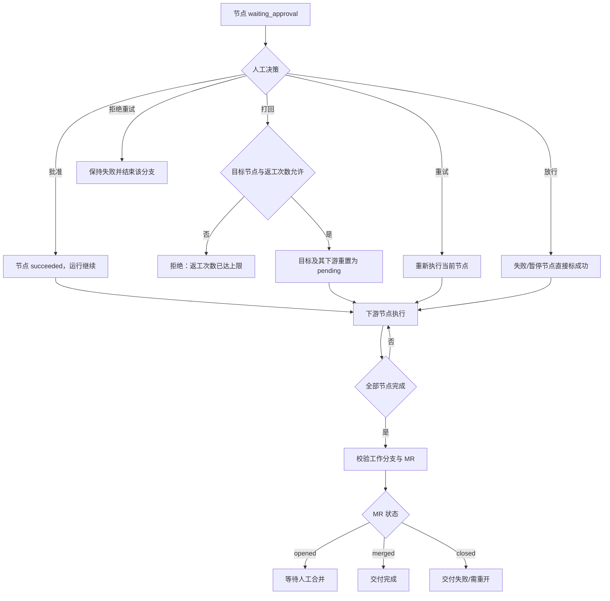
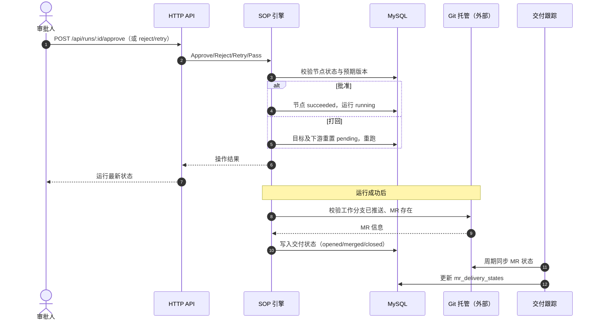
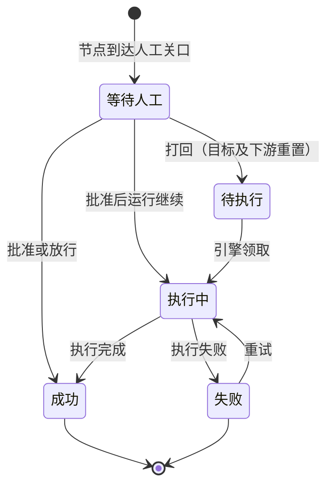

# 05 运行审批与交付（v1）

> 文档编号：05
> 文档版本：v1
> 项目：LoopForge
> 关联接口：`POST /api/runs/:id/approve`、`POST /api/runs/:id/reject`、`POST /api/runs/:id/decline-retry`、`POST /api/runs/:id/pass`、`POST /api/runs/:id/retry`、`POST /api/runs/:id/resume`
> 状态：已实现
> 证据基线：`develop` @ `6833a9fb`

## 1. 流程目标

运行在人工关口暂停后，由成员批准、打回返工、重试或放行；运行成功后核对工作分支与 MR 是否存在，并持续跟踪 MR 的合入状态。

## 2. 参与角色与前置条件

| 角色 | 职责 |
| --- | --- |
| 审批人 | 在「待我确认」或运行详情页做出决策 |
| HTTP API | 校验权限与节点预期，调用引擎操作 |
| SOP 引擎 | 修改节点状态、重置返工范围、恢复运行 |
| Git 托管【外部】 | 接收分支、创建/合并 MR |
| DeliveryRepo | 记录 MR 交付状态与同步 |
| MySQL | runs、run_nodes、run_artifacts、mr_delivery_states |

前置条件：节点处于 `waiting_approval`（人工关口）；审批人拥有该项目/运行的权限；工作区绑定实例可用（多实例部署时审批需落在绑定实例）。

## 3. 主流程图

## 4. 时序图

## 5. 状态机

交付状态（MR）由外部托管返回：`opened`、`reopened`、`closed`、`merged`；无法判定时为 `unknown`。`merged` 只能由外部状态或已合入证据得出，不由平台臆测。

## 6. 关键异常与分支

| 场景 | 当前处理 |
| --- | --- |
| 节点不是 waiting_approval | 拒绝操作并返回错误 |
| 返工次数达到上限 | 拒绝打回 |
| 打回目标不存在 | 拒绝操作 |
| 工作区绑定在其他实例 | 要求在绑定实例审批，或清理绑定后重试 |
| 需求在外部已关闭 | 禁止继续审批/打回 |
| MR 缺失或未覆盖最新提交 | 交付校验失败，运行不标为已交付 |
| MR 被关闭 | 交付失败，需要重开或重新推送 |

## 7. 证据索引

| 证据 | 位置 |
| --- | --- |
| 批准/放行 | `internal/engine/run_ops.go`（`Approve`、`Pass`） |
| 打回与返工上限 | `internal/engine/run_ops.go`（`Reject`） |
| 重试/恢复 | `internal/engine/run_ops.go`（`Retry`、`ResumePaused`、`DeclineRetry`） |
| MR 校验 | `internal/engine/gate_mr.go`（`verifyRunMRs`） |
| 定时运行集成分支 | `internal/engine/integrate.go` |
| MR 状态分类 | `internal/domain/mr.go` |
| 交付状态同步 | `internal/tracker/mr_delivery_sync.go` |
| 路由 | `internal/httpapi/server.go`（`/api/runs/:id/*`） |

## 8. 实现风险与待确认

- 审批操作带节点预期（`NodeExpectation`）防止并发覆盖；界面需要传递最新版本。
- `Pass` 是运维兜底动作，绕过了节点失败，需在审计中可追溯。
- 定时运行的集成分支合并只发生在工作分支 → 集成分支；集成分支 → 主分支仍由人完成。
- MR 状态依赖外部 API，网络异常时交付状态可能滞后，以同步任务下一次结果为准。
