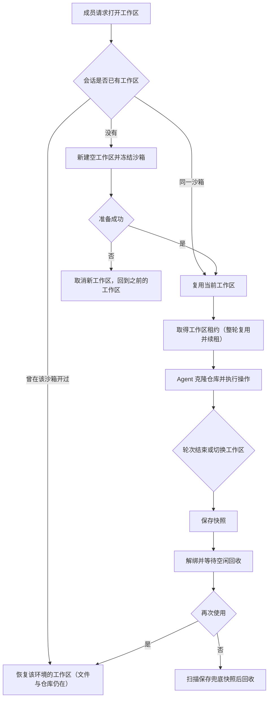
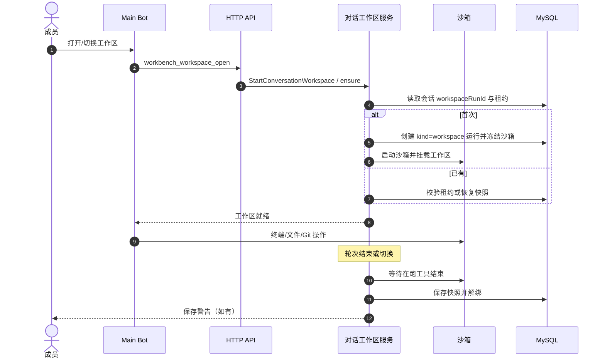
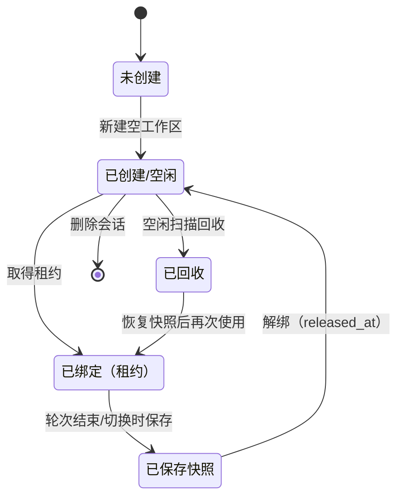

# 06 对话工作区与沙箱（v1）

> 文档编号：06
> 文档版本：v1
> 项目：LoopForge
> 关联接口：`PUT /api/assistant/sessions/:id/sandbox`、`GET /api/runs/:id/workspace*`、`POST /api/assistant/sessions/:id/edit`
> 状态：已实现
> 证据基线：`develop` @ `6833a9fb`

## 1. 流程目标

Main Bot 在对话中可以打开一个可编辑的仓库工作区：冻结沙箱环境、克隆仓库、在轮次内持有租约，并在轮次结束或切换时保存快照；空闲后回收，切回时恢复。

## 2. 参与角色与前置条件

| 角色 | 职责 |
| --- | --- |
| 成员 | 在对话里要求打开/切换工作区、选择沙箱 |
| Main Bot / 工具网关 | 打开或切换工作区，执行终端、文件与浏览器操作 |
| 对话工作区服务 | 创建 `kind=workspace` 运行、绑定会话、租约与快照 |
| 沙箱（Docker / native） | 承载 CLI 与命令执行 |
| MySQL | assistant_sessions、runs、工作区检查点与租约 |

前置条件：会话已绑定项目或为个人工作区；选择的沙箱在执行环境可用；Compose 部署下只能使用 Docker 沙箱（无 bwrap）。

## 3. 主流程图

## 4. 时序图

## 5. 状态机

说明：SOP 运行中的工作区不参与对话工作区回收，生命周期由 SOP 自己决定；借用 SOP 工作区在删除会话时不受影响。

## 6. 关键异常与分支

| 场景 | 当前处理 |
| --- | --- |
| 切换环境 | 旧工作区解绑，文件保留；新环境复用或新建工作区 |
| 保存失败 | 不阻止切换；记录 `previousCheckpointError`，空闲回收前再次保存 |
| 保存超限/超时 | 轮次收尾通过 `workspaceWarning` 返回，不静默丢失 |
| 租约被他人持有 | 中止本轮生成或提示工作区占用 |
| SOP 仍在执行 | 工作区只读；需先 pause/cancel 才进入工作区模式 |
| 删除会话 | 删除该会话开过的所有工作区；借用的 SOP 工作区不受影响 |
| Compose 部署用 native | 不可用：容器无法创建命名空间，需 Docker 沙箱或在 Runner/原生安装运行 |
| 子 SOP 共享父工作区 | 拒绝单独操作，要求从父任务操作 |

## 7. 证据索引

| 证据 | 位置 |
| --- | --- |
| 创建对话工作区 | `internal/engine/chat_workspace.go`（`StartConversationWorkspace`） |
| 准备与租约 | `internal/engine/conversation_workspace.go`（`prepareConversationWorkspace`、`ensureConversationWorkspace`） |
| 工作区准备 | `internal/engine/workspace_preparation.go` |
| 快照与恢复 | `internal/engine/workspace_checkpoint_*.go`、`workspace_restore.go` |
| 清理与空闲回收 | `internal/engine/workspace_cleanup.go` |
| 终端与浏览器 | `internal/runtime/workspace_terminal.go`、`browser_view.go` |
| 官方说明 | [功能/06-对话工作区与原生CLI.md](../功能/06-对话工作区与原生CLI.md) |

## 8. 实现风险与待确认

- 工作区与快照各自保存 Git 对象，存储增长需要容量规划。
- Docker/native 行为差异明显（cwd、HOME、Docker 可达性），排障必须先确认沙箱类型。
- 旧版 Runner 不支持新工作区请求，会返回版本要求；升级需 API 与 Runner 同步。
