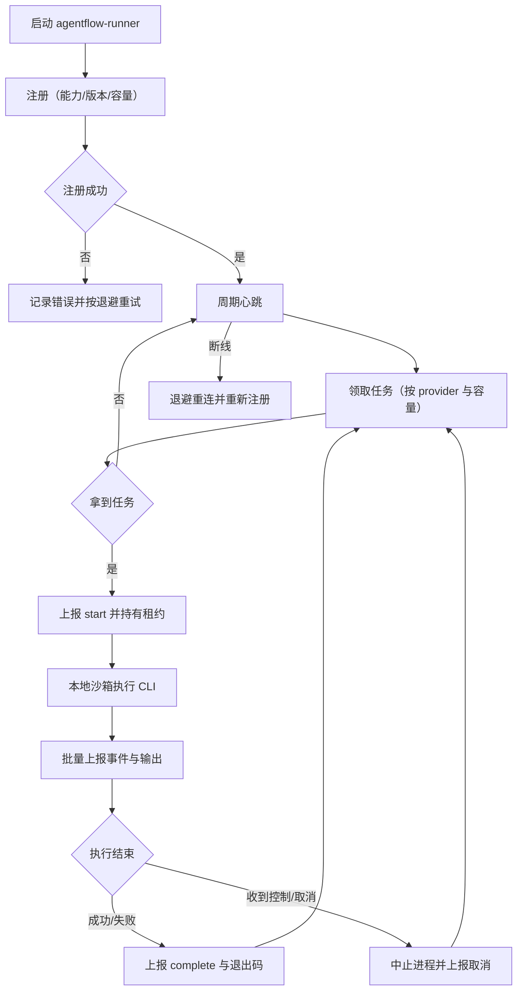
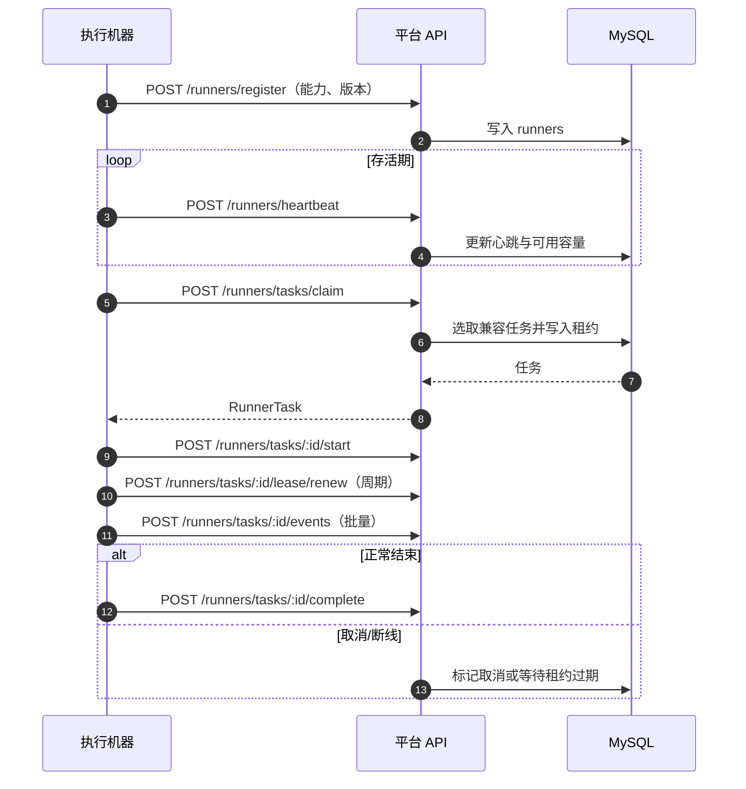
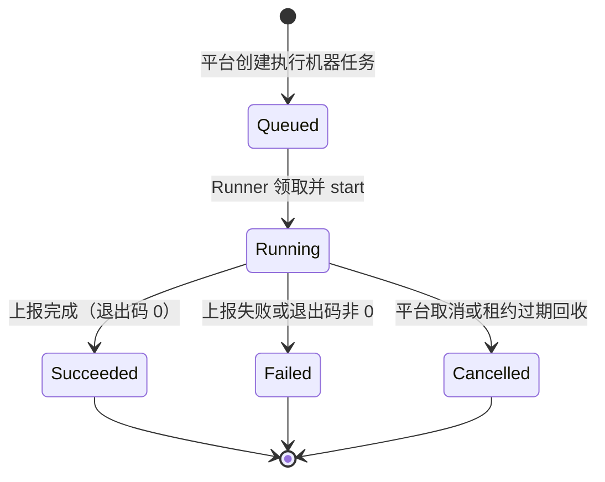

# 07 执行机器调度（v1）

> 文档编号：07
> 文档版本：v1
> 项目：LoopForge
> 关联接口：`POST /runners/register`、`POST /runners/heartbeat`、`POST /runners/tasks/claim`、`POST /runners/tasks/:id/events`、`POST /runners/tasks/:id/complete`
> 状态：已实现
> 证据基线：`develop` @ `6833a9fb`

## 1. 流程目标

执行机器（Runner）注册到平台、维持心跳，按能力与容量领取任务，在本地沙箱执行模型 CLI 并把事件与结果回传；租约过期或平台控制时能安全中止。

## 2. 参与角色与前置条件

| 角色 | 职责 |
| --- | --- |
| 平台 API | 维护 Runner 注册表、任务队列、租约与控制 |
| 执行机器守护进程 | 注册、心跳、领取、执行、上报、重连 |
| 本地沙箱 / CLI | 实际执行任务 |
| MySQL | runners、runner_tasks、runner_task_events、租约 |

前置条件：Runner 已安装并能访问平台（出站网络）；注册凭据有效；本机具备所选 CLI 与沙箱能力；平台与 Runner 版本兼容。

## 3. 主流程图

## 4. 时序图

## 5. 状态机

状态取值：`queued`、`running`、`succeeded`、`failed`、`cancelled`（`internal/repo/runners.go` 与 `internal/runner/` 写入值）。

## 6. 关键异常与分支

| 场景 | 当前处理 |
| --- | --- |
| 注册失败/凭据无效 | 记录错误并退避重试，不领取任务 |
| 心跳丢失 | 平台在租约过期后回收任务；Runner 重连后重新注册 |
| 平台取消 | 通过控制通道中止本地进程并上报取消 |
| 容量已满 | 不再领取，直到本地任务释放槽位 |
| 版本不兼容 | 平台拒绝新工作区请求，返回版本要求 |
| 事件上报失败 | 批量重试；最终以 complete 结果结算 |

## 7. 证据索引

| 证据 | 位置 |
| --- | --- |
| Runner 协议端点 | `internal/httpapi/runners.go`、`runner_ws.go` |
| 守护进程 | `internal/runner/daemon.go`（`Run`、`registerLocked`、`heartbeatLoop`、`claimLoop`） |
| 任务执行 | `internal/runner/exec.go`、`task_lease.go` |
| 控制通道 | `internal/runner/control.go` |
| 注册表与任务 | `internal/repo/runners.go` |
| 数据结构 | `internal/domain/runner.go`（`RunnerTask`） |

## 8. 实现风险与待确认

- 平台与 Runner 必须同步升级；新工作区请求对旧 Runner 会明确报版本要求。
- 租约过期回收依赖时钟一致性；多平台实例部署需统一时间源。
- 断线期间本地任务继续执行的风险由控制通道与进程守护（`procwatch`）共同约束，需在 Runner 侧监控。
