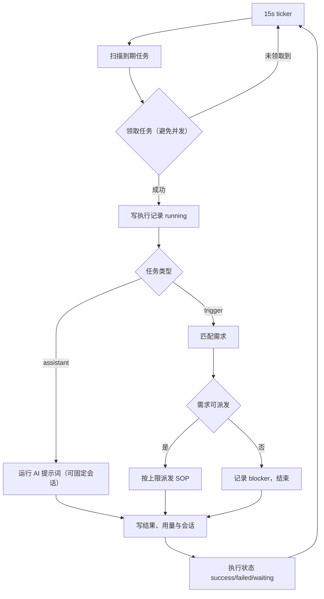
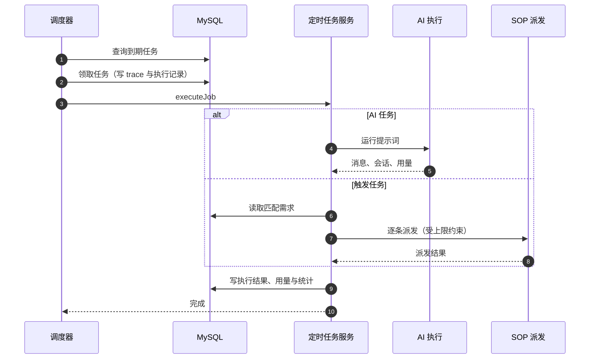
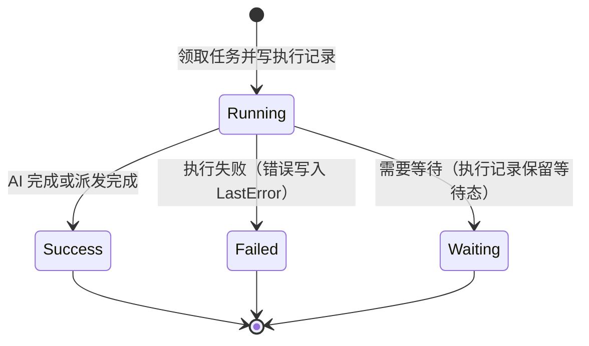

# 08 定时任务（v1）

> 文档编号：08
> 文档版本：v1
> 项目：LoopForge
> 关联接口：`GET/POST /api/schedule-jobs`、`POST /api/schedule-jobs/:id/run`、`GET /api/schedule-job-executions`、`GET /api/shared-schedule-tasks`
> 状态：已实现
> 证据基线：`develop` @ `6833a9fb`

## 1. 流程目标

按 cron 触发定时任务：一种是 AI 提示词任务（在固定或新会话中运行模型），另一种是触发任务（扫描符合条件的需求并派发 SOP）；每次触发都留执行记录与用量。

## 2. 参与角色与前置条件

| 角色 | 职责 |
| --- | --- |
| 调度器 | 15s ticker 检查到期任务，串行派发锁 |
| 定时任务服务 | 领取任务、写执行记录、运行 AI 或派发 SOP |
| 对话工作台 / 派发器 | 执行 AI 提示词或把需求交给 SOP |
| MySQL | schedule_jobs、schedule_job_executions、schedule_job_execution_stats |

前置条件：任务已保存且启用；项目与执行器凭据有效；触发任务有匹配的需求与 SOP 绑定；调度器所在实例承担 worker 角色。

## 3. 主流程图

## 4. 时序图

## 5. 状态机

执行状态取值证据：`internal/domain/schedule_execution.go` 注释（`running, success, failed, waiting`）。

## 6. 关键异常与分支

| 场景 | 当前处理 |
| --- | --- |
| 任务被编辑/重跑 | 执行结束保存最新存储状态，不覆盖并发编辑 |
| 触发任务无匹配需求 | 记录拉取数与阻塞原因，状态 success |
| 需求已跑过该 SOP | 派发器拒绝，记录 blocker |
| AI 会话固定 | 复用 FixedSessionID；否则新建并记录 LastSessionID |
| 进程重启 | `recoverInterruptedJobs` 恢复中断执行 |
| 派发上限 | 按任务的 DispatchLimit 截断并记录已派发数 |

## 7. 证据索引

| 证据 | 位置 |
| --- | --- |
| 调度器启动与 ticker | `internal/schedule/service.go`（`Start`，15s） |
| 执行主流程 | `internal/schedule/service.go`（`executeJob`） |
| 需求派发 | `internal/schedule/service.go`（`dispatchIssue`） |
| 执行记录 | `internal/domain/schedule_execution.go` |
| 任务模型与 cron | `internal/domain/shared_schedule.go`、`schedule_job*` 表 |
| 路由 | `internal/httpapi/schedule.go`、`schedule_executions.go` |

## 8. 实现风险与待确认

- 到期判定依赖服务器时间与 cron 表达式；多实例部署时由数据库领取避免重复执行，但仍依赖时钟一致。
- 触发任务的“已跑过”判断与手动派发共用任务键，冲突提示不同。
- 执行记录保留策略未在本流程展开，清理/归档需按运维策略单独配置。
