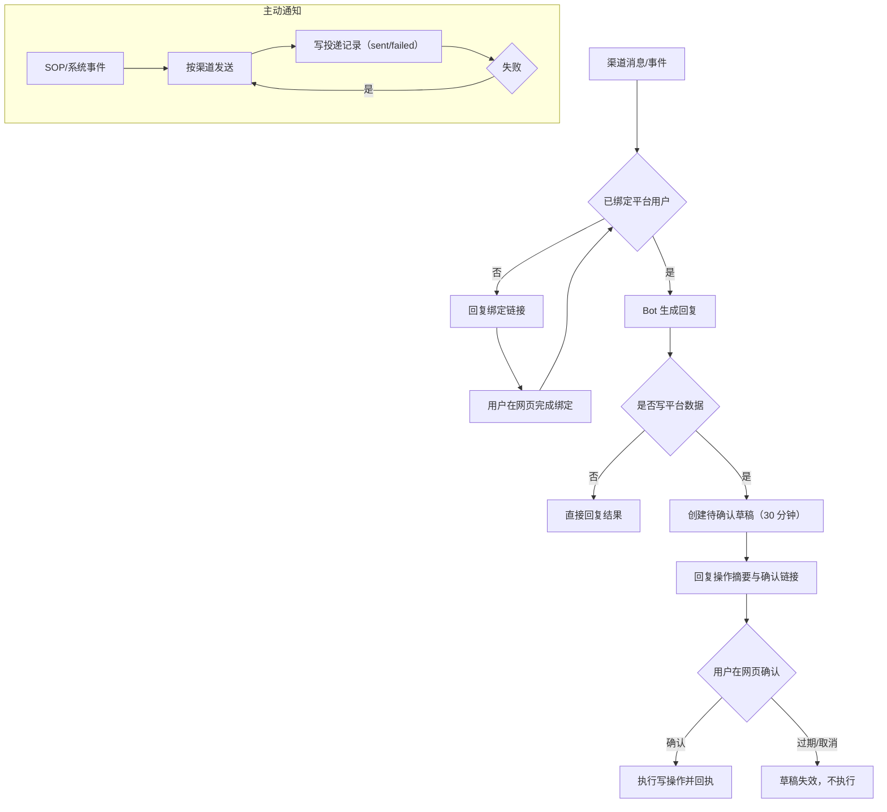
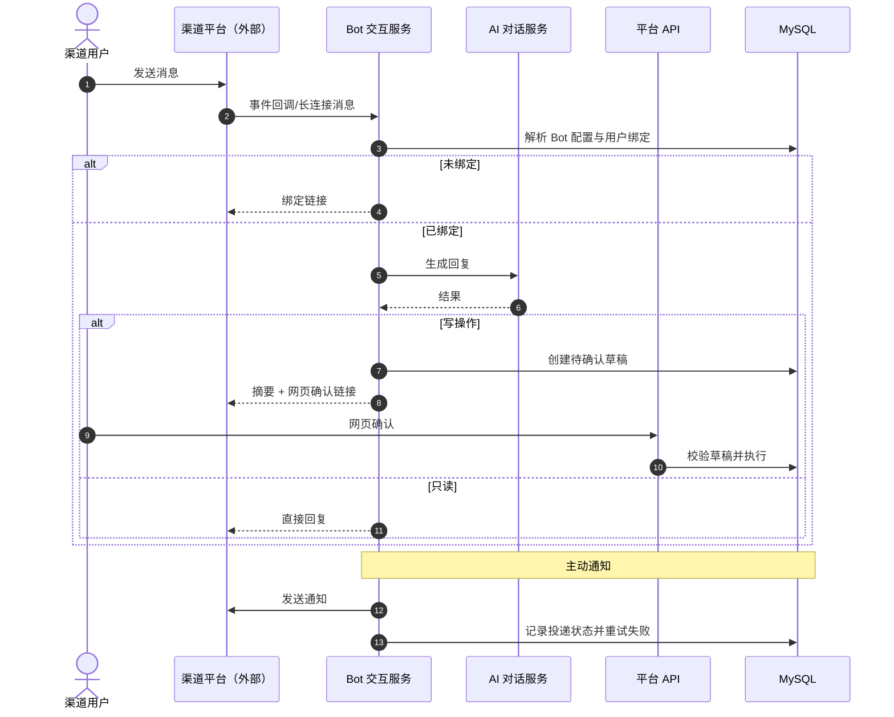
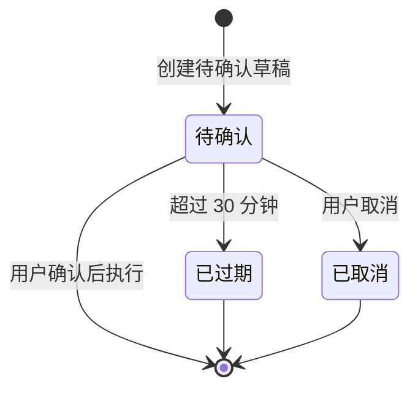

# 09 渠道Bot与通知（v1）

> 文档编号：09
> 文档版本：v1
> 项目：LoopForge
> 关联接口：`GET/POST /api/notification-bots`、`POST /api/bot-bindings/claim`、`POST /api/bot-drafts/:id/confirm`、`GET /api/notification-deliveries`
> 状态：已实现
> 证据基线：`develop` @ `6833a9fb`

## 1. 流程目标

企业微信、飞书、钉钉中的用户通过与平台 Bot 对话来提问或执行写操作；未绑定的用户先完成绑定。对平台数据的写操作以「网页确认」执行，SOP 与系统的主动通知按渠道投递并记录重试。

## 2. 参与角色与前置条件

| 角色 | 职责 |
| --- | --- |
| 渠道用户 | 在 IM 中私聊或群聊 @ Bot |
| 渠道平台【外部】 | 事件推送、消息发送、长连接 |
| Bot 交互服务 | 解析消息、绑定、生成回复、发起确认草稿 |
| AI 对话服务 | 生成自然语言回复 |
| 通知服务 | 主动通知投递、重试与记录 |
| MySQL | notification_bots、user_bot_bindings、bot_pending_drafts、notification_deliveries |

前置条件：`AGENTFLOW_CREDENTIAL_KEYS` 已配置（否则新 Secret 保存返回 503）；`AGENTFLOW_BOT_WORKERS_ENABLED=true`；`AGENTFLOW_PUBLIC_URL` 可被用户访问；渠道应用已配置回调/订阅。

## 3. 主流程图

## 4. 时序图

## 5. 状态机

投递状态：`pending`、`sending`、`sent`、`failed`（`notification_deliveries` 与通知服务写入值）。

## 6. 关键异常与分支

| 场景 | 当前处理 |
| --- | --- |
| 未配置凭据密钥 | 保存新 Secret 返回 503 `credential_key_missing`；旧明文仍可读 |
| 维护窗口 | `AGENTFLOW_BOT_WORKERS_ENABLED=false` 时接收/发送/清理停止，写配置返回 503 |
| 写操作未确认 | 草稿 30 分钟过期，不执行 |
| 发送失败 | 投递记录 failed，按队列重试 |
| 用户未绑定 | 回复绑定链接，完成绑定后才处理请求 |
| 记录保留 | 正文默认 90 天、记录默认 180 天清理；0 表示保留 |
| 渠道回调异常 | 记录日志并按渠道要求重试/幂等处理 |

## 7. 证据索引

| 证据 | 位置 |
| --- | --- |
| 渠道实现 | `internal/botinteraction/channel_wecom.go`、`channel_feishu.go`、`channel_dingtalk.go` |
| 交互与绑定 | `internal/botinteraction/service.go`、`internal/httpapi/bot_identities.go` |
| 待确认草稿 | `internal/httpapi/bot_drafts.go`、`bot_pending_drafts` |
| 通知投递 | `internal/notification/service.go`、`internal/httpapi/notifications.go` |
| 加密封存 | `internal/credcrypt/`、`AGENTFLOW_CREDENTIAL_KEYS` |
| 官方手册 | `docs/im-channels.md` |

## 8. 实现风险与待确认

- 密钥丢失后已存 Secret 无法解密，只能重填；`.env` 中的 `AGENTFLOW_CREDENTIAL_KEYS` 必须与数据库备份一起保管。
- 数据保留清理会作用于升级前的历史数据，升级前必须确认保留设置。
- 企业微信新建 Bot 默认只读，已有 Bot 保持自动执行；两种权限语义需在运维文档中区分。
- 回退到旧版本必须恢复备份，不能只回滚二进制（密文与租约协议不兼容）。
