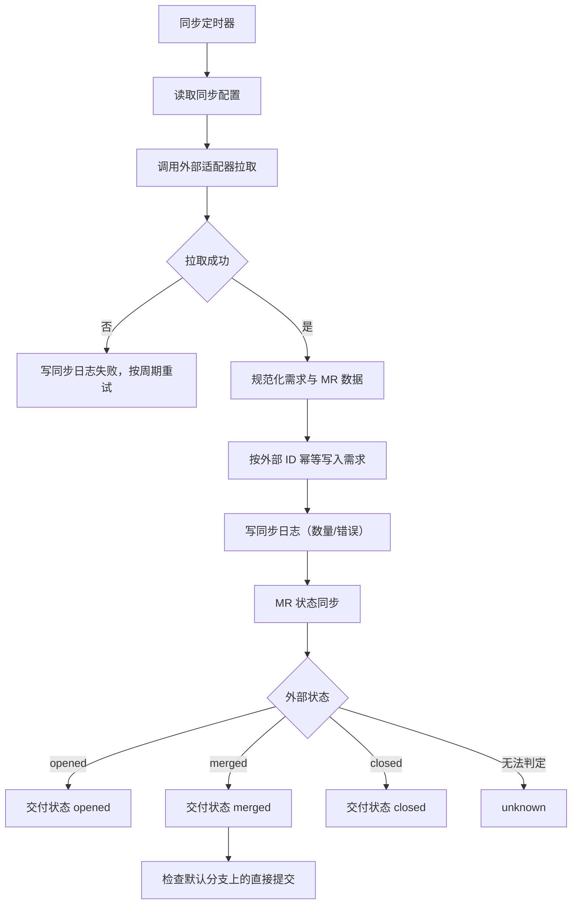
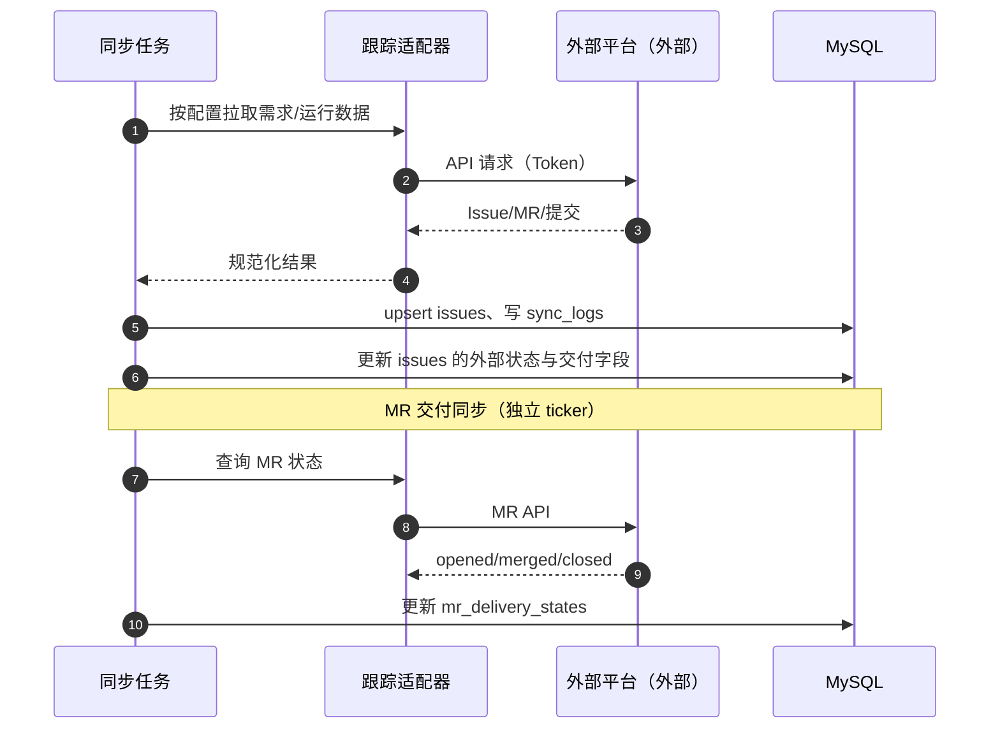
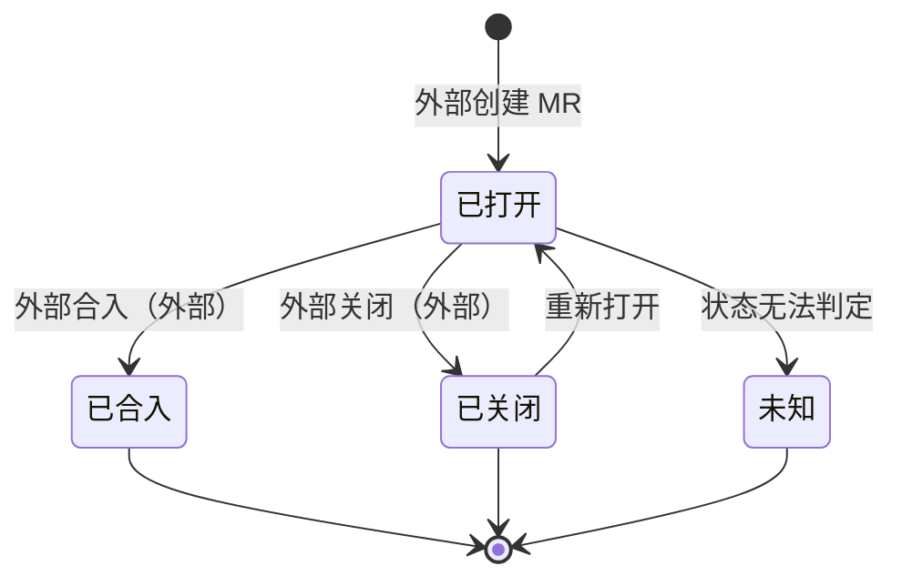

# 10 仓库同步与MR跟踪（v1）

> 文档编号：10
> 文档版本：v1
> 项目：LoopForge
> 关联接口：`GET/PUT /api/sync/config`、`POST /api/sync/run`、`GET /api/sync/logs`、仓库与 MR 相关端点见接口附录
> 状态：已实现
> 证据基线：`develop` @ `6833a9fb`

## 1. 流程目标

定期从外部跟踪平台（GitHub、Gongfeng、TAPD 等）拉取需求与 MR 状态，把需求写入本地并在运行结束后持续跟踪交付状态；同时识别已直接合入默认分支的提交，避免误报未交付。

## 2. 参与角色与前置条件

| 角色 | 职责 |
| --- | --- |
| 同步任务 | 周期触发拉取，写同步日志 |
| 跟踪适配器 | 按平台协议读取需求、MR、提交 |
| 外部 Git/跟踪平台【外部】 | 提供 Issue、MR、提交数据 |
| DeliveryRepo | 记录 MR 交付状态 |
| MySQL | sync_config、sync_logs、issues、mr_delivery_states |

前置条件：项目已配置同步来源与凭据（个人/项目 Token 或 MCP）；信任主机（HTTPS/SSH）已获平台批准；网络可达。

## 3. 主流程图

## 4. 时序图

## 5. 状态机

状态取值来自 `internal/domain/mr.go`：`opened`、`reopened`（归一为 opened）、`closed`、`merged`、`unknown`。

## 6. 关键异常与分支

| 场景 | 当前处理 |
| --- | --- |
| 外部 API 不可达 | 写同步日志失败，保留上次状态，按周期重试 |
| Token 失效 | 同步失败并提示重新授权；不覆盖已有数据 |
| MR 无法判定 | 状态记为 unknown，不声称已合入 |
| 提交已直接合入默认分支 | 通过默认分支提交检查识别，避免误报 |
| 外部需求已关闭 | 本地记录关闭来源，禁止继续审批派发 |
| 多来源同名 | 以外部 ID/来源组合区分，不按标题合并 |

## 7. 证据索引

| 证据 | 位置 |
| --- | --- |
| 自动同步 | `internal/tracker/service.go`（`StartAutoSync`） |
| MR 交付同步 | `internal/tracker/mr_delivery_sync.go`（`StartMRStateSync`） |
| GitHub/Gongfeng 适配 | `internal/tracker/github.go`、`external_mr.go`、`gongfeng*` |
| TAPD 同步 | `internal/tracker/tapd_*.go` |
| 同步配置与日志 | `internal/domain/sync.go`、`internal/httpapi/sync.go` |
| MR 状态分类 | `internal/domain/mr.go` |
| 路由 | `internal/httpapi/server.go`（`/api/sync/*`、仓库端点） |

## 8. 实现风险与待确认

- 交付状态依赖外部平台与网络，滞后时以同步任务的下一轮结果为准。
- 不同跟踪平台的字段语义差异大，术语映射需按平台维护（见 [03-领域术语表](../功能/03-领域术语表.md)）。
- 直接合入默认分支的识别只覆盖可查询到的提交，私有权限不足时可能漏判。
