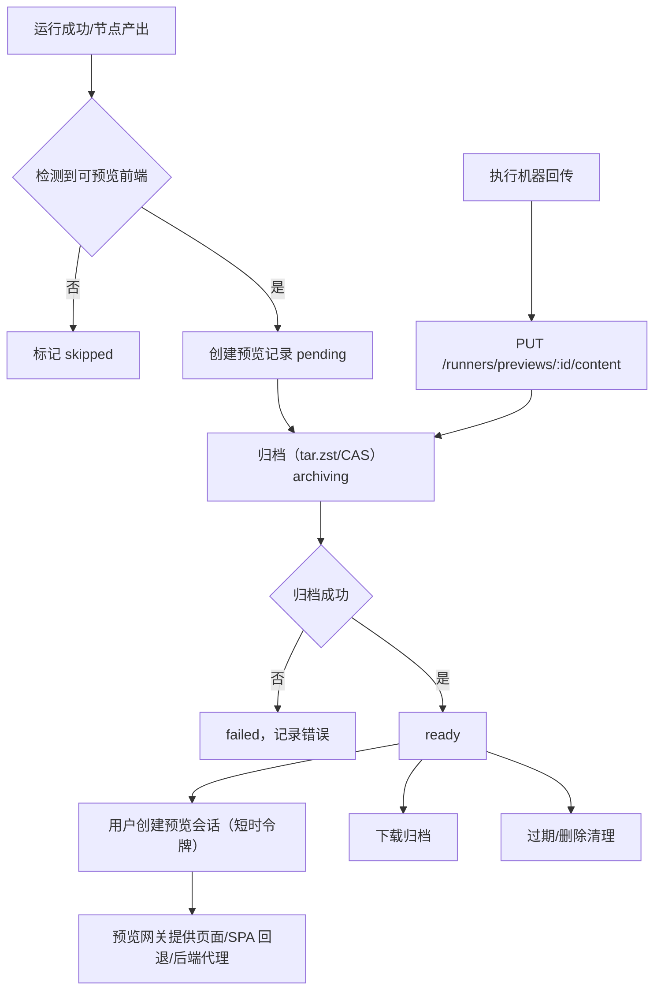
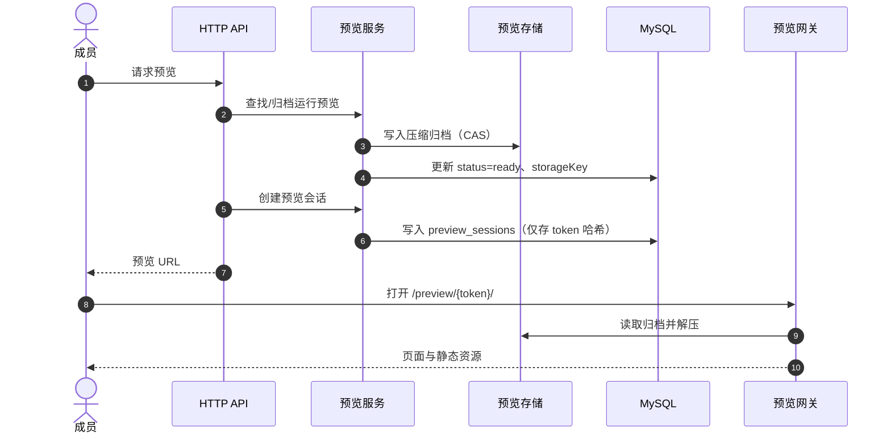
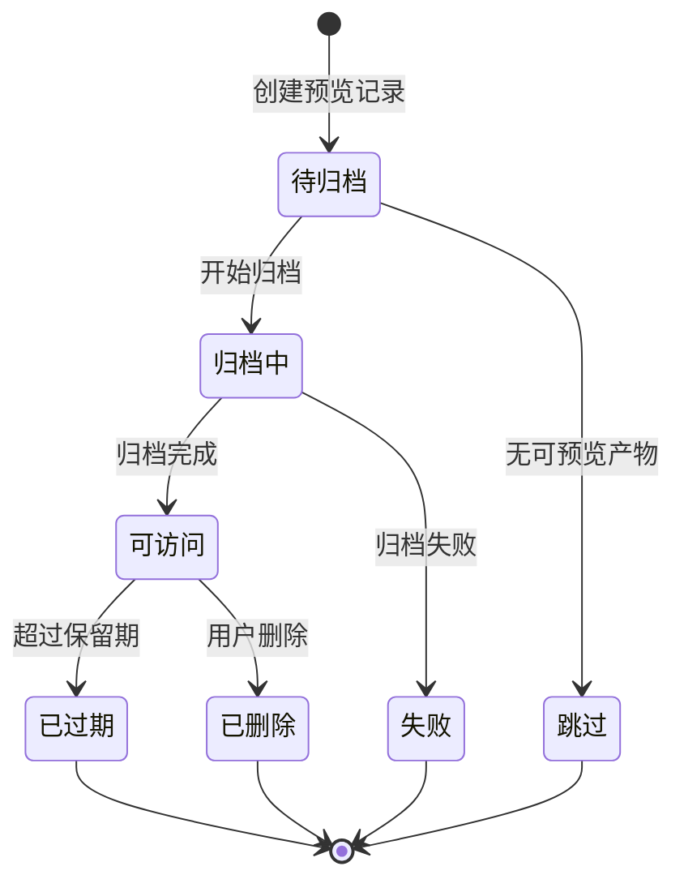

# 11 预览与产物（v1）

> 文档编号：11
> 文档版本：v1
> 项目：LoopForge
> 关联接口：`GET /api/runs/:id/preview`、`GET /api/runs/:id/preview/download`、`POST /api/runs/:id/preview/session`、`PUT /runners/previews/:previewId/content`
> 状态：已实现
> 证据基线：`develop` @ `6833a9fb`

## 1. 流程目标

把运行产生的静态前端打包成可访问的预览：归档入库、按需创建访问会话、通过预览网关提供页面与下载；支持执行机器回传预览内容，并在过期或删除时清理存储。

## 2. 参与角色与前置条件

| 角色 | 职责 |
| --- | --- |
| 成员 | 打开预览、切换后端、下载产物 |
| 预览服务 | 检测可预览产物、归档、会话与网关路由 |
| 执行机器（可选） | 构建并回传预览压缩包 |
| 预览存储 | 保存压缩归档（CAS） |
| MySQL | run_previews、preview_sessions、preview_blobs |

前置条件：运行已产生前端产物或执行机器回传预览；预览功能已启用；公网访问需 `AGENTFLOW_PREVIEW_PUBLIC_URL` 与相应端口/域名配置。

## 3. 主流程图

## 4. 时序图

## 5. 状态机

状态常量证据：`internal/domain/preview.go`（`pending`、`archiving`、`ready`、`failed`、`skipped`、`deleted`、`deleting`、`expired`）。

## 6. 关键异常与分支

| 场景 | 当前处理 |
| --- | --- |
| 无可预览产物 | 标记 skipped，不创建归档 |
| 归档失败 | 标记 failed 并记录错误文本 |
| 执行机器未上传 | 预览保持待归档/失败，等待上传或重试 |
| 会话令牌过期 | 重新创建预览会话 |
| 归档被删除/过期 | 预览不可访问，需要重新归档 |
| 后端地址变更 | 更新预览会话的后端配置，不影响归档 |

## 7. 证据索引

| 证据 | 位置 |
| --- | --- |
| 检测与归档 | `internal/preview/service.go`（`ArchiveBuiltPreview`、`ArchiveLocal`） |
| 归档格式 | `internal/preview/archive.go` |
| 网关 | `internal/preview/gateway.go`（`ServeHTTP`） |
| 会话 | `internal/preview/service.go`（`CreateSession`） |
| 下载 | `internal/preview/download.go` |
| 数据结构 | `internal/domain/preview.go`（`RunPreview`、`PreviewSession`） |
| 路由 | `internal/httpapi/run_preview.go` |

## 8. 实现风险与待确认

- 预览二进制只存 PreviewStore，不进 `run_artifacts.content`；清理策略与容量需要独立规划。
- 执行机器回传与平台本地归档是两条路径，排障需先确认预览的 owner。
- 预览会话只存令牌哈希，丢失链接只能重新创建。
