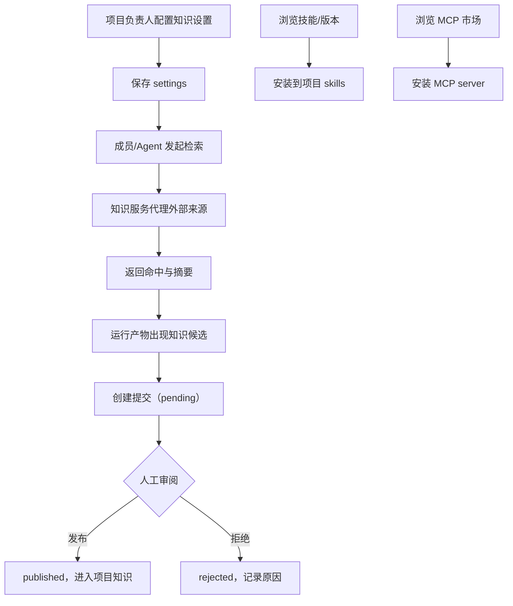
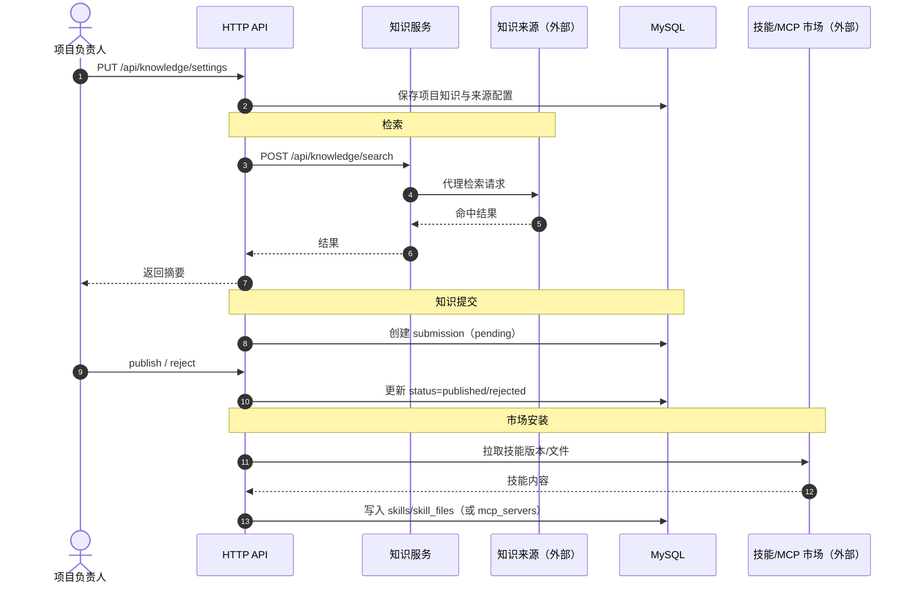
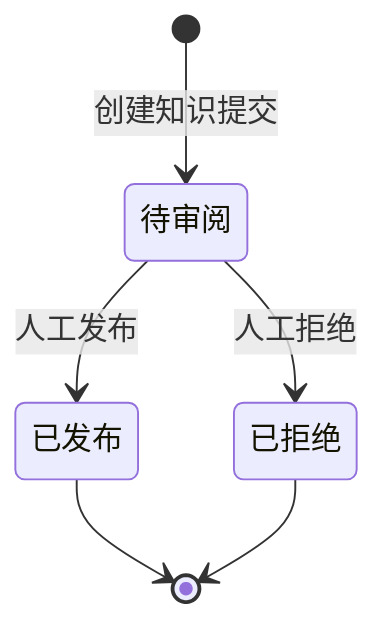

# 12 知识库与技能市场（v1）

> 文档编号：12
> 文档版本：v1
> 项目：LoopForge
> 关联接口：`GET/PUT /api/knowledge/settings`、`POST /api/knowledge/search`、`POST /api/knowledge/submissions/:id/publish`、`POST /api/skillhub/install`、`POST /api/mcp-market/install`
> 状态：已实现
> 证据基线：`develop` @ `6833a9fb`

## 1. 流程目标

项目可以配置外部知识库并让 Agent 检索；运行产物中的「知识候选」经人工审阅后发布为项目知识。同时可以从技能市场与 MCP 市场安装能力，写入项目目录。

## 2. 参与角色与前置条件

| 角色 | 职责 |
| --- | --- |
| 项目负责人 / 管理员 | 配置知识库、审阅并发布/拒绝提交 |
| 成员 / Agent | 检索知识、把产物提交为知识候选 |
| 知识服务 | 代理外部检索、计算候选、管理提交 |
| 技能市场 / MCP 市场【外部】 | 提供技能与 MCP 定义 |
| MySQL | knowledge_settings、knowledge_submissions、skills、skill_files、mcp_servers |

前置条件：调用方具备项目访问权；知识管理操作需要项目负责人或平台管理员；安装技能需要目标项目存在。

## 3. 主流程图

## 4. 时序图

## 5. 状态机

状态常量证据：`internal/knowledge/service.go`（`KnowledgeSubmissionPending`、`...Rejected`、`...Published`）。

## 6. 关键异常与分支

| 场景 | 当前处理 |
| --- | --- |
| 无项目权限 | 拒绝配置、审阅与安装 |
| 外部知识源不可达 | 检索返回错误，不缓存错误结果 |
| 提交内容为空/路径无效 | 拒绝创建或发布 |
| 技能版本不存在 | 安装失败并返回市场错误 |
| 已安装同名技能 | 返回已安装项或要求更新，不静默覆盖 |
| MCP 市场安装冲突 | 按市场返回错误，保留原有配置 |

## 7. 证据索引

| 证据 | 位置 |
| --- | --- |
| 知识设置与检索 | `internal/httpapi/knowledge.go`、`internal/knowledge/service.go`、`client.go` |
| 知识提交状态 | `internal/domain/knowledge.go`、`internal/knowledge/service.go` |
| 技能市场 | `internal/httpapi/skillhub_client.go`、`skillhub_market.go` |
| MCP 市场 | `internal/httpapi/mcp_market.go` |
| 路由 | `internal/httpapi/server.go`（`/api/knowledge/*`、`/api/skillhub/*`、`/api/mcp-market/*`） |

## 8. 实现风险与待确认

- 知识库是外部代理，检索质量与权限由外部来源决定；平台不缓存正文。
- 技能安装会写入项目目录，需遵守仓库许可与来源说明。
- 市场安装需要外网访问；离线部署需预置技能/MCP 定义。
