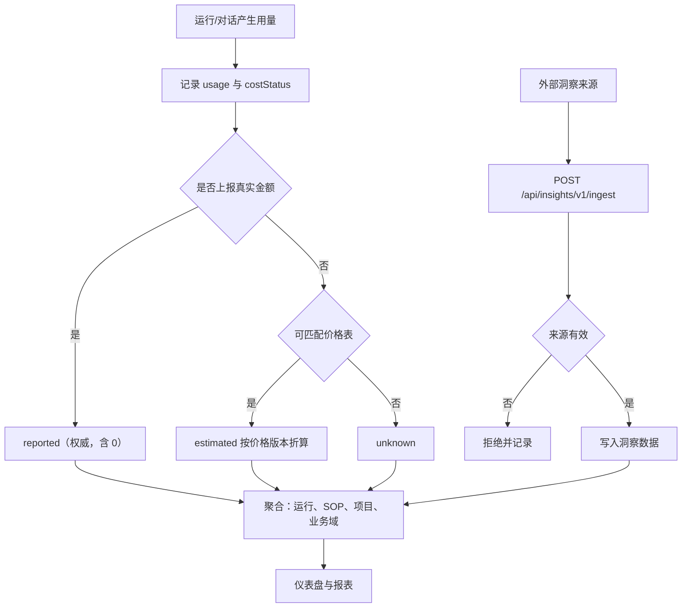
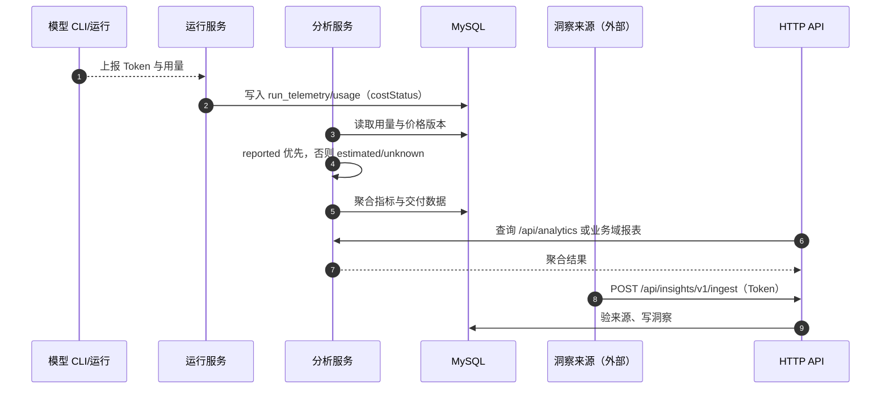
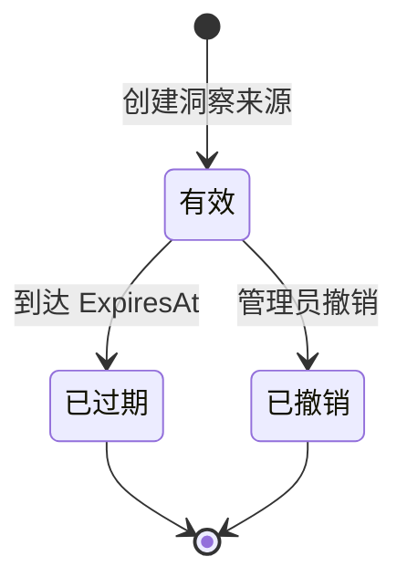

# 13 统计与成本（v1）

> 文档编号：13
> 文档版本：v1
> 项目：LoopForge
> 关联接口：`GET /api/analytics`、`GET /api/business-domain-report`、`POST /api/insights/v1/ingest`、`GET /api/workflow-metrics`
> 状态：已实现
> 证据基线：`develop` @ `6833a9fb`

## 1. 流程目标

把运行用量按统一价格口径折算为成本，汇总为运行分析、SOP 绩效与业务域报表；同时接收外部洞察事件并按来源鉴权。

## 2. 参与角色与前置条件

| 角色 | 职责 |
| --- | --- |
| 成员 / 管理员 | 查看统计、导出报表 |
| 运行与对话 | 上报 Token 用量与成本状态 |
| 分析服务 | 按价格版本折算、聚合与查询 |
| 洞察来源【外部】 | 通过 Token 写入外部指标/事件 |
| MySQL | run_telemetry、run_evals、insight_sources、insight_executions |

前置条件：调用方有项目或业务域查看权限；外部洞察来源已创建且未过期/撤销；价格表版本与用量记录匹配。

## 3. 主流程图

## 4. 时序图

## 5. 状态机

来源状态由 `domain.InsightSource` 的 `ExpiresAt` 与 `RevokedAt` 表达；成本口径 `reported`/`estimated`/`unknown` 是写入时的分类，不是可迁移状态。

## 6. 关键异常与分支

| 场景 | 当前处理 |
| --- | --- |
| 上报金额为 0 | 视为权威 reported，不重新估算 |
| 无账单且无价格 | 记为 unknown，不猜测金额 |
| 价格版本不匹配 | 按当前版本重算或记为 unknown，取决于记录中的版本 |
| 洞察来源过期/撤销 | 拒绝 ingest |
| 业务域权限不足 | 报表返回未授权或空集 |
| 演示/未上报执行 | 成本为 0 或 unknown，不伪装为已上报 |

## 7. 证据索引

| 证据 | 位置 |
| --- | --- |
| 成本折算 | `internal/domain/token_pricing.go`（`AnalyticsPricingVersion`、`reported` 优先） |
| 运行分析 | `internal/httpapi/runs.go`（`analytics`）、`internal/domain/analytics*.go` |
| 业务域报表 | `internal/httpapi/business_domains.go`、`internal/domain/business_domain.go` |
| 洞察来源与 ingest | `internal/httpapi/insights.go`、`internal/domain/insights.go` |
| 价格说明 | `docs/token-pricing.md` |
| 路由 | `internal/httpapi/server.go` |

## 8. 实现风险与待确认

- 成本是估算与上报的混合口径，对外展示必须标注 `costStatus`，不能统一称为账单。
- 外部洞察来源使用 Token 前缀与过期时间控制，撤销后不可恢复，需要重新创建。
- 业务域归属会随项目变更转移，历史报表按当时归属快照，不随当前归属重算。
