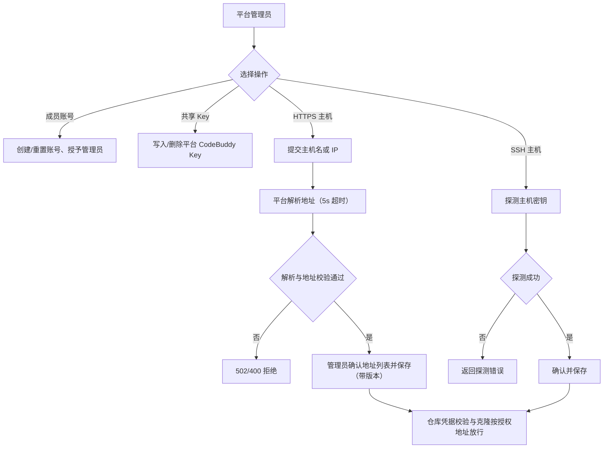
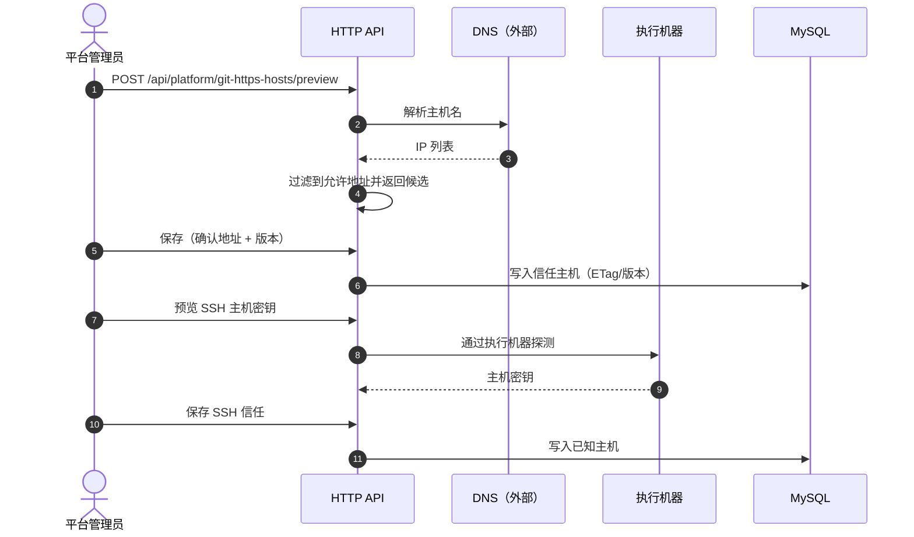
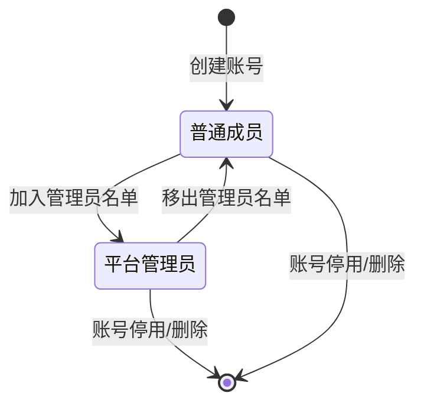

# 14 平台管理与信任主机（v1）

> 文档编号：14
> 文档版本：v1
> 项目：LoopForge
> 关联接口：`GET/POST /api/platform/accounts`、`PUT /api/platform/admins`、`GET/PUT/DELETE /api/platform/codebuddy-key`、`GET/POST/PUT/DELETE /api/platform/git-https-hosts`、`/api/platform/git-ssh-hosts`
> 状态：已实现
> 证据基线：`develop` @ `6833a9fb`

## 1. 流程目标

平台管理员维护成员账号与管理员名单、配置平台共享 CodeBuddy Key，并把自建 Git 主机加入信任列表：HTTPS 主机先解析 IP 再人工确认，SSH 主机先探测主机密钥再保存。

## 2. 参与角色与前置条件

| 角色 | 职责 |
| --- | --- |
| 平台管理员 | 账号、管理员、共享 Key、Git 信任主机 |
| HTTP API | 权限校验、地址/主机密钥校验、版本冲突控制 |
| DNS【外部】 | 解析 HTTPS 主机地址 |
| 执行机器（SSH） | 探测 SSH 主机密钥 |
| MySQL | users、platform_codebuddy_keys、信任主机配置 |

前置条件：操作者是平台管理员（`platform_role=admin`）；HTTPS 主机可解析且地址在允许范围内；SSH 探测需要可用的执行机器。

## 3. 主流程图

## 4. 时序图

## 5. 状态机

平台角色由 `users.platform_role` 表达，写入路径为 `SetUserPlatformRole`；Git 信任主机没有独立状态机，以创建/更新/删除与版本号控制。

## 6. 关键异常与分支

| 场景 | 当前处理 |
| --- | --- |
| 非平台管理员 | 403，拒绝所有管理写操作 |
| HTTPS 主机无法解析 | 502，提示检查服务端 DNS |
| 地址不在允许范围 | 400，拒绝保存 |
| 版本冲突 | 使用 ETag/修订号，冲突时要求刷新后重试 |
| SSH 探测失败 | 返回探测错误，不保存未知主机密钥 |
| 共享 Key 删除 | 仅删除平台共享 Key，个人 Key 不受影响 |
| 最后一个管理员被移除 | 需产品/运维确认策略（当前未强制保留） |

## 7. 证据索引

| 证据 | 位置 |
| --- | --- |
| 平台账号 | `internal/httpapi/platform_settings.go` |
| 管理员名单 | `internal/httpapi/users.go`、`internal/repo/platform_admin.go` |
| HTTPS 主机信任 | `internal/httpapi/git_https_hosts.go`、`internal/domain/https_host.go` |
| SSH 主机信任 | `internal/httpapi/ssh_host_trust.go` |
| Git 出口限制 | `internal/gitegress/gitegress.go`（`AGENTFLOW_GIT_EGRESS_ALLOW_CIDRS`） |
| 官方部署说明 | [功能/05-部署与运维.md](../功能/05-部署与运维.md) |

## 8. 实现风险与待确认

- 信任主机保存是平台管理员权限；误加会扩大可访问的 Git 出口范围。
- HTTPS 地址列表由人工确认，DNS 变更后需要重新预览与保存。
- “最后一个管理员”策略未在代码中强制，运维需要额外约束。
- SSH 主机密钥探测依赖执行机器在线，离线时无法完成授权。
